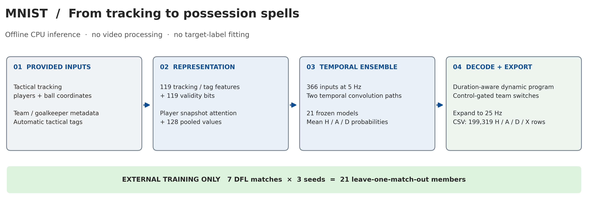
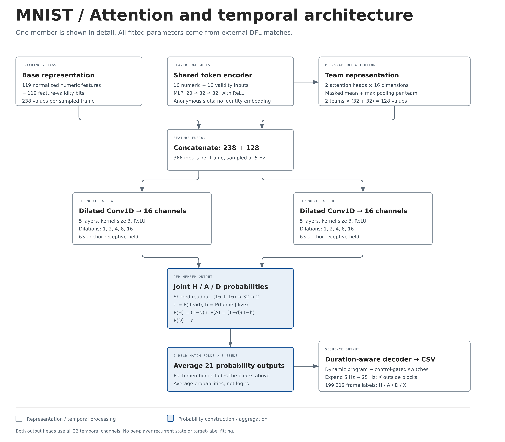
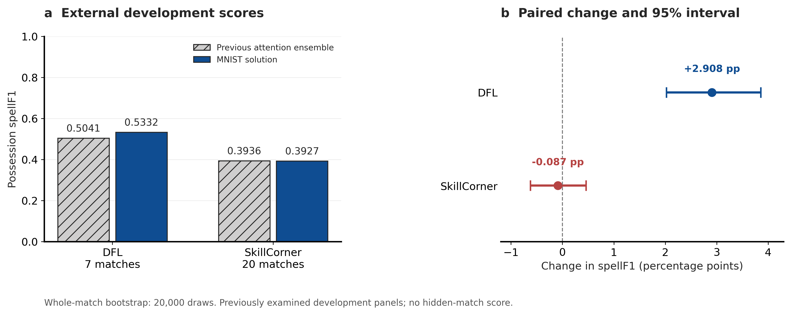
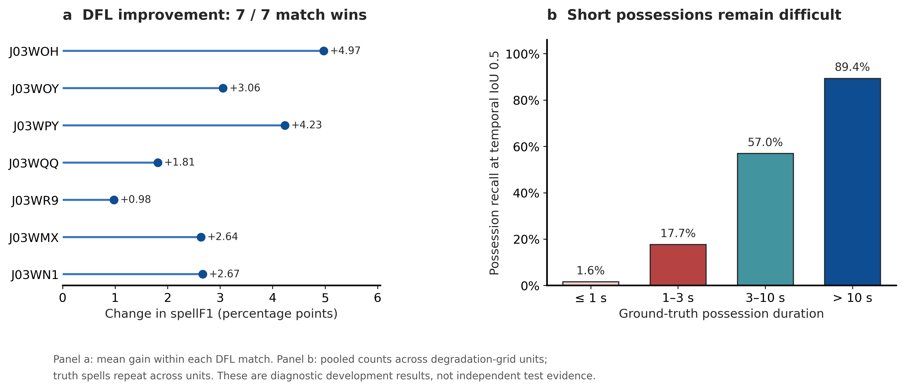

# MNIST — Football Possession Inference

**Team:** Dimash Rakishev, Dauren Izdibay, Diyar Ildartov, Ayan Kokhan,
Aneliya Kuneyeva.

**Submission:** `MNIST.csv`, regenerated by the `solution` candidate. The CSV
contains 199,319 rows indexed from 0 to 199318, with labels H (home possession),
A (away possession), D (dead ball) and X (ungraded frames).

## Approach and rationale

The competition ranks possession spells rather than individual frame accuracy.
We therefore combine learned temporal probabilities with duration-aware
segmentation, avoiding frame-by-frame nearest-player switches on deflections
and noisy observations.

The algorithm reads tactical tracking, tactical XML metadata and automatic
Smart Tagging. Normalized tracking coordinates are converted to metres using
the published 105.3 × 68.0 m pitch. Supplied slot-to-team membership,
goalkeeper roles and first-half direction supply metadata. Club names in the
metadata map Smart Tagging team strings to home/away. Positions and shirt
numbers are not used to infer identity.

At 5 Hz, 119 features describe ball position and motion, nearby players,
relative speeds, team movement and spread, missingness, tag membership and
clocks. Eight of these features describe SET PIECES team and type. GOALS
membership and clocks are used, but GOALS team metadata is not. Tag intervals
are observations, not possession labels. Fixed external normalization and
119 validity bits produce 238 base inputs.

Each observed player also has ten snapshot features: position, local velocity,
and displacement to the nearest opponent, teammate and ball. Validity bits
accompany these features. A shared embedding feeds a two-head self-attention
block with learned same-team bias, residual LayerNorm and a width-64
feedforward block. Masked mean and maximum pooling across players produce
128 values. These are concatenated with the 238 base inputs.

Two parallel width-16 temporal convolution paths process the resulting 366
inputs. Each path has five kernel-three layers with dilations 1/2/4/8/16,
covering 63 sampled positions. Both output heads read all 32 temporal channels.
They predict dead-ball probability d and home-given-live probability h, giving
P(D)=d, P(H)=(1−d)h and P(A)=(1−d)(1−h). Training minimizes joint H/A/D negative
log likelihood; dead frames contribute no owner-loss gradient.

Seven held-match folds and three seeds (2026, 2027, 2028) yield 21 frozen
models. Each member was trained for 24 epochs on six DFL matches, excluding
its held match from fitting and normalization. Six members originated in the
discovery experiment; fifteen continued the same shared-readout recipe on
the remaining folds. Inference averages all 21 probability outputs. There is
no target adaptation, runtime fitting, temperature calibration or seed selection.

Exact dynamic programming combines these probabilities with DFL-fitted
transition and duration priors. Duration weight is 0.1; switch penalty and
auxiliary dead-model blend are zero. A switch or restart needs confirmed
control evidence or conditional live-team probability at least 0.55. The
priors and control constants use all seven external matches. The path expands
from 5 Hz to 25 Hz. The two graded blocks, 11185–90651 and 110808–190197
(inclusive), have independent temporal context. Other frames are X.



*Figure 1. Tactical inputs become tracking and attention features, temporal
probabilities and duration-aware possession spells. All fitted parameters
come from external DFL matches.*



*Figure 2. One ensemble member: 238 base values and a 128-value pooled player
representation feed two temporal paths. Their 16-channel outputs are
concatenated; both binary heads read all 32 channels. Joint H/A/D probabilities
are averaged over 21 members before duration-aware decoding. Layer dimensions
are checked against the packaged weights. [Vector PDF](figures/architecture.pdf)
and [offline HTML](figures/architecture.html) are available.*

An additional layer-by-layer rendering made with PlotNeuralNet/TikZ is
available as [PDF](figures/plotneuralnet.pdf), [PNG](figures/plotneuralnet.png)
and [editable LaTeX source](figures/plotneuralnet.tex).

## Possession rules and imperfect tracking

Loose-ball and challenge states are resolved by temporal probabilities and
control-gated transitions. A nearby opponent or isolated touch does not force
an immediate ownership change. Stoppages are D; restart ownership follows
control evidence or the live-team posterior. These are learned proxies for
the competition's controlled-possession definition, not referee decisions.
There are no manually corrected labels or exceptions tied to individual
match frames beyond the organisers' published graded blocks.

Missing coordinates remain NaN during feature extraction. Normalization maps
missing numeric inputs to centered zero with a zero validity bit, using only
external fitted means and scales. Ball-absence duration and observed player
movement remain available. Player slots are anonymous. Snapshot pooling is
invariant to token order, but local velocity still assumes same-slot
continuity over five frames. Unmarked identity switches can corrupt velocity.

External robustness experiments simulated fragmentation with mean 20-second
tracklets, randomized same-team assignment, 5% loss and role confusion, and
1% duplication. An equally weighted eight-cell grid varied tracking noise,
gaps and tag retention. No simulator setting was fitted to the target match.
Simulation is not evidence that the target has an identical error distribution.

## Assets, training data and attribution

The final inference path uses only the provided tactical ATD text, tactical
metadata XML and Smart Tagging XML. It does not read video, audio, broadcast
tracking or homography. Competition assets are not distributed here.

All accepted weights, normalization, control constants and priors were fitted
on [DFL/IDSSE Bundesliga data, version 1](https://doi.org/10.6084/m9.figshare.28196177.v1),
released by Manuel Bassek, Robert Rein, Hendrik Weber and Daniel Memmert under
**CC BY 4.0**. It contains seven matches, fourteen halves and 1,002,644 frames
at 25 Hz (about 668 minutes). The match IDs are J03WOH, J03WOY, J03WPY,
J03WQQ, J03WR9, J03WMX and J03WN1. Provider tracking labels supply supervision:
BallStatus=0 maps to D; otherwise BallPossession=1/2 maps to H/A. Event XML
supplies simulated tags. Individual provider annotators are not identified
in the release. Provider possession semantics may differ from the challenge.

Other labelled external sources used during development were:

- [SkillCorner open data](https://github.com/SkillCorner/opendata), MIT,
  source revision `4340d274572876239c154c90bc507a9b3250a656`:
  the 20-match panel contains 40 halves and 2,955,525 frames after resampling
  from 10 Hz to 25 Hz. The rejected training addition used 15 matches,
  30 halves and 2,216,400 frames: 1874553, 1899585, 1925299, 1927964,
  1953632, 1959846, 1996436, 2006229, 2006363, 2007448, 2007721,
  2010085, 2011166, 2013725 and 2017461. The remaining five matches
  (1886347, 1986691, 1996435, 2015213 and 2016236) were excluded from
  that fit. Provider `possession.group` supplied H/A, absent phases mapped
  to D, and unknown labels to X. These are provider-derived labels, not
  independently verified human possession annotations. Its weights are
  not in this package.
- [SoccerTrack v2](https://huggingface.co/datasets/atomscott/soccertrack-v2),
  CC BY 4.0, release v1.2 revision
  `325bd4c57ee8e135ab652f3921d274526ada496b`: the rejected players-only
  training addition used ten matches, twenty halves and 1,398,024 frames
  at 25 Hz: 117092, 117093, 118575, 118576, 118577, 118578, 128057,
  128058, 132831 and 132877. Ball coordinates were missing throughout;
  event annotations were used only to derive weak supervision, not as
  model inputs. The latest BAS actor/team supplied H/A after mapping
  left/right teams through the roster; OUT or GOAL supplied D until
  THROW IN, FREE KICK, PASS, HIGH PASS, CROSS or SHOT. Ambiguous or
  unavailable labels mapped to X and contributed no loss. These event
  proxies are not independent possession ground truth. Separate external
  visual-model validation used four half-videos. No model trained on
  this source enters the final ensemble.

The rejected training pool sizes above describe available frames, not exact
optimizer exposure: training sampled windows, with X labels contributing no
loss. They were recovered from the retained preparation manifest and training
notes. SkillCorner supplies provider annotations; SoccerTrack supplies event
annotations from which the weak labels were derived. Individual annotators
are not identified in those records; dataset authors are not assumed to be
the annotators.
They were not used to label the target match. Their source media and
annotations are not redistributed with this package.

Rejected modalities included an external visual-model prototype, a fixed
pretrained whistle detector that produced no onsets, and a broadcast-ball
simulation that failed its external improvement gate. No visual model saw
target frames; whistle thresholds were not adjusted on target audio. These
experiments do not affect serving. No AudioSet audio was downloaded or used
for tuning. The MIT upstream-code notice and data attribution appear in
[THIRD_PARTY_LICENSES.md](THIRD_PARTY_LICENSES.md).

## Evidence and limitations

Recorded development cross-validation on the seven-match degraded DFL panel
was **0.533151 spellF1**, versus 0.504072 for the earlier snapshot-attention
reference: gain +0.029079, seven of seven match wins, paired-match 95% interval
[+0.020213, +0.038564]. MacroF1 improved by 0.005044. On the previously examined
20-match SkillCorner panel, the final ensemble scored **0.392735 spellF1**,
versus reference scores 0.393600 and 0.395500. It passed the prospectively
fixed transfer tolerance, but did not improve mean SkillCorner spellF1.



*Figure 3. MNIST versus the previous snapshot-attention ensemble. DFL improves
by +0.029079 spellF1; SkillCorner changes by −0.000865. Intervals use the
original whole-match bootstrap. Neither panel is a hidden-match score.*

These are historical development results, not newly rerun benchmarks or a
competition score. Repeated use of the external panels, reuse of discovery
models and adaptive follow-up experiments limit the strength of the evidence.
The earlier reference's transfer tolerance was amended after its result;
the final candidate used that tolerance prospectively. Candidate ranking
used external DFL results with SkillCorner eligibility guards. External
training and benchmark harnesses are not part of this inference-only package.
Training commit identifiers and model provenance metadata are retained in
the exports; package release labels and filenames have been renamed.

Target public labels were used only for pipeline correctness checks, never
training, tuning or selection. No private ground truth or other human-produced
target-match labels were used. This does not establish hidden-match accuracy.
Main risks are provider-label semantics, domain shift, missing-ball transition
errors, corrupted same-slot velocity and merged short opponent possessions.
More independent external games with compatible controlled-possession labels
would provide a stronger evaluation before changing the model.



*Figure 4. Improvement is positive in all seven DFL matches. Possessions of
one second or less have only 1.6% recall at temporal IoU 0.5, compared with
89.4% for possessions longer than ten seconds. Duration counts pool repeated
degradation-grid units, rather than unique independent possessions. Plotting
inputs, provenance and generation instructions are in [figures/README.md](figures/README.md).*

## Reproduction

From the repository root with Python 3.12 (tested on 3.12.14):

```bash
python3.12 -m venv .venv
.venv/bin/python -m pip install .
export MTAH_DATA_DIR="/path/to/More Than A Hack 2027 - Initial Challenge - Dataset"
.venv/bin/python -m possession.run --candidate solution --out reproduced.csv --data-dir "$MTAH_DATA_DIR"
```

Use a new output path. All 21 models and the manifest are packaged with the
source. Inference uses fixed thread counts and NumPy 2.5.4, requires no network
or training libraries, and typically took about 65 seconds on the original
certification CPU. The submitted `MNIST.csv` and reproduced output must have
this SHA256:

```text
16cd851d2f55c28f34f5ea0b30b45bc88d59c38f3e809182a0a132fcb8a96f4e
```

[README.md](README.md) includes byte verification, tests and the command for
the unmodified official validator. That validator checks all 199,319 rows,
frame ordering and the H/A/D/X alphabet. Reproduction is checked separately
from prediction quality. Frozen model parameters are supplied; retraining is
not required to regenerate the submission.
